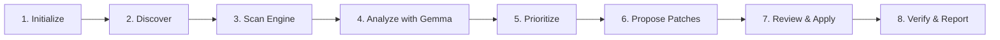

# QuietPatch 🌿

> **Your project works. QuietPatch makes it ready to ship.**
> *A local-first AI repository caretaker powered by Gemma for Hacktoberfest 2026 DEV Open-Source AI Challenge, Week 3: "Slow and Steady."*

---

## 1. What QuietPatch Does

Every engineering team accumulates maintenance tasks that get continually postponed: broken internal markdown links, undocumented environment variables causing staging outages, unpinned dependencies, missing packaging scripts, and lingering `# TODO` and `# FIXME` comments.

**QuietPatch is not another general-purpose AI chat bot or hallucinating code generator.**

Instead, it acts as a **deliberate, slow-and-steady repository caretaker**:
1. **Deterministic Discovery & Scanning:** Discovers files while strictly respecting `.gitignore` and security limits; executes real AST and pattern scanners across documentation, configuration, TODOs, Python, and TypeScript.
2. **Gemma-Powered Analysis & Prioritization:** Feeds grounded evidence to an open-weight Gemma model to explain why each defect matters and assign a realistic severity (`critical`, `high`, `medium`, `low`, `informational`).
3. **Reviewable, Minimal Code Patches:** Synthesizes surgical, targeted fixes presented as unified diffs.
4. **Explicit User Approval:** Zero automatic writes. Every file modification requires explicit confirmation.
5. **Safe Patch & Undo Engine:** Verifies original file contents, creates safe backups in `.quietpatch/backups/`, applies patches atomically, and provides conflict-aware rollback.
6. **Real Verification Checks:** Reruns deterministic rules or allowlisted test commands (`pytest`, `npm test`) to confirm that the issue was genuinely resolved.
7. **Sentry Agent Tracing:** End-to-end performance spans for all 8 agent workflow stages.
8. **Lazy Payoff Accounting:** Transparently tallies estimated manual developer minutes avoided.

---

## 2. Architecture & The Caretaker Workflow

QuietPatch follows an 8-stage sequential workflow:



### Visual Architecture

```
┌────────────────────────────────────────────────────────────────────────┐
│                        QuietPatch Web Interface                        │
│             React 19 + TypeScript + Vite + Tailwind CSS v4             │
│   [Overview] [Repositories] [Maintenance Runs] [Fix Queue] [Reports]   │
└────────────────────────────────────┬───────────────────────────────────┘
                                     │ JSON REST API
┌────────────────────────────────────▼───────────────────────────────────┐
│                          QuietPatch Backend                            │
│                  Python 3.12+ Flask + Pydantic v2                      │
│                                                                        │
│  ┌────────────────────────┐         ┌───────────────────────────────┐  │
│  │   Deterministic Scan   │         │     Safe Patch & Undo Engine  │  │
│  │         Engine         │         │ - Path Containment Boundary   │  │
│  │ - TODO & Markers       │         │ - Content SHA / Conflict Check│  │
│  │ - Broken Markdown Links│         │ - Atomic Backups (.quietpatch)│  │
│  │ - Config / .env Parity │         │ - Rollback / Revert Service   │  │
│  │ - Python & JS Packaging│         │ - Allowlisted Test Verifiers  │  │
│  └───────────┬────────────┘         └───────────────▲───────────────┘  │
│              │ Grounded Findings                    │                  │
│  ┌───────────▼──────────────────────────────────────┴───────────────┐  │
│  │                     Gemma AI Provider Layer                      │  │
│  │  - Mode A: Local Gemma via Ollama (gemma4:e4b)                   │  │
│  │  - Mode B: Hosted Gemma via Google Gen AI SDK (gemma-4-26b-a4b)  │  │
│  │  - Mode C: Demonstration Mode (Zero Credentials)                 │  │
│  └──────────────────────────────────┬───────────────────────────────┘  │
│                                     │                                  │
│  ┌──────────────────────────────────▼───────────────────────────────┐  │
│  │                     Sentry Agent Tracing                         │  │
│  │  Custom spans for Discovery, Scanners, Gemma, Patches, Verify    │  │
│  └──────────────────────────────────────────────────────────────────┘  │
└────────────────────────────────────────────────────────────────────────┘
```

---

## 3. Execution Modes & Privacy Boundaries

QuietPatch provides three explicit AI execution modes:

### Mode A: Local Gemma (Privacy-First, Primary Experience)
- **Configuration:** `APP_MODE=local`, `AI_PROVIDER=ollama`, `OLLAMA_MODEL=gemma4:e4b`
- Backend connects to local Ollama daemon (`http://localhost:11434`).
- **Privacy Guarantee:** Private code **never** leaves your local machine.
- Fully offline capable once model weights are pulled.
- Checks Ollama reachability and provides actionable terminal commands (`ollama pull gemma4:e4b`) if missing.

### Mode B: Hosted Gemma (Render Production Demo)
- **Configuration:** `APP_MODE=hosted`, `AI_PROVIDER=gemma_api`, `GEMMA_API_KEY=...`
- Uses Google's official `google-genai` Python SDK with `gemma-4-26b-a4b-it`.
- API keys are strictly retained on the backend and never exposed to client browsers.
- Displays a visible privacy notice before submitting snippets.

### Mode C: Demonstration Mode (Zero Credentials)
- **Configuration:** `AI_PROVIDER=demo`
- Automatically active when running without external API keys or Ollama.
- Exercises deterministic scanners and displays curated, realistic Gemma analyses and unified diffs.
- Clearly labeled with demo badges so users know live models were not invoked.

---

## 4. Getting Started Locally

### Prerequisites
- Python 3.12+ (or 3.13)
- Node.js 20+ and npm
- (Optional for Mode A) [Ollama](https://ollama.ai) with `gemma4:e4b` or `gemma:7b`

### 1. Clone & Set Up Python Environment
```bash
git clone https://github.com/your-username/QuietPatch.git
cd QuietPatch

# Create and activate virtual environment
python3 -m venv .venv
source .venv/bin/activate  # On Windows: .venv\Scripts\activate

# Install backend dependencies
pip install -r requirements.txt
```

### 2. Set Up Frontend
```bash
cd frontend
npm install
npm run build
cd ..
```

### 3. Configure Environment Variables
```bash
cp .env.example .env
```
Edit `.env` as desired:
```env
APP_MODE=local
AI_PROVIDER=demo     # Or 'ollama' or 'gemma_api'
QUIETPATCH_ALLOWED_ROOT=.
```

### 4. Run the Application
In development, run backend and frontend concurrently:

**Terminal 1 (Backend):**
```bash
source .venv/bin/activate
python backend/app.py
# Server running at http://localhost:5001
```

**Terminal 2 (Frontend Dev Server):**
```bash
cd frontend
npm run dev
# Frontend running at http://localhost:3000 (proxies API to 5001)
```

Open `http://localhost:3000` in your browser.

---

## 5. Running Tests

### Backend Test Suite (Pytest)
QuietPatch includes 22 automated tests covering scanners, path containment, conflict detection, patch undo, and API endpoints:
```bash
source .venv/bin/activate
pytest tests/ -v
```

### Frontend Test Suite (Vitest)
```bash
cd frontend
npm test
```

---

## 6. Sentry Agent Tracing

QuietPatch integrates official Sentry Python SDK instrumentation for agent tracing.

### Setting Up Sentry:
1. Obtain a Sentry DSN from [sentry.io](https://sentry.io).
2. Set `SENTRY_DSN=https://your-dsn@sentry.io/project-id` in `.env`.
3. Set `SENTRY_TRACES_SAMPLE_RATE=1.0` during testing.
4. Run a maintenance scan.
5. In Sentry, navigate to **Performance &gt; Traces**.
6. Inspect the custom agent spans:
   - `QuietPatch Stage: Repository Discovery`
   - `QuietPatch Stage: Scanner: TodoScanner`
   - `QuietPatch Stage: Scanner: DocScanner`
   - `QuietPatch Stage: Scanner: ConfigScanner`
   - `QuietPatch Stage: Gemma Issue Analysis`
   - `QuietPatch Stage: Patch Validation & Application`
   - `QuietPatch Stage: Deterministic Verification Check`

**Telemetry Sanitization Guarantee:** QuietPatch explicitly filters out raw source code, full diffs, filesystem paths, and secrets before transmitting any span metadata to Sentry.

---

## 7. Render Deployment

QuietPatch is production-ready for deployment as a single containerized Render Web Service.

### Quick Deploy via Render Blueprint
1. Push this repository to GitHub.
2. In the Render Dashboard, click **New &gt; Blueprint**.
3. Select your repository. Render will detect `render.yaml` and configure:
   - Docker runtime (`Dockerfile`)
   - Health check path `/api/health`
   - Configurable environment variables
4. Optionally add your `GEMMA_API_KEY` and `SENTRY_DSN` in Render's Environment Settings.
5. In hosted mode, patch previews and static analysis remain fully functional, while unsafe file modifications and arbitrary shell execution on the container are disabled.

---

## 8. License & Model Attribution

QuietPatch is licensed under the [MIT License](LICENSE).

- **Gemma:** Powered by Google's open-weight Gemma models under the Gemma Terms of Use.
- **Sentry:** Tracing telemetry powered by the official `sentry-sdk`.
- **Lucide:** Visual icons licensed under the ISC License.
