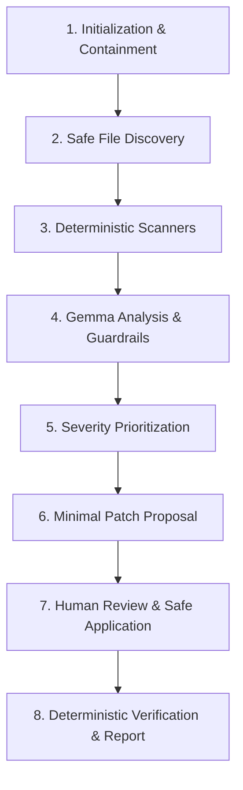

*This is a submission for the Hacktoberfest 2026 DEV Open-Source AI Challenge — Week 3: "Slow and Steady."*

**Prize Categories Entered:**
- 🏆 Best Use of Gemma
- 🏆 Best Use of Sentry Agent Tracing
- 🏆 Best Use of Render

---

## 1. What I Built

Every software engineer knows the uncomfortable feeling of looking at a repository that runs fine in development, but carries a steady undercurrent of postponed chores:

- The README links to a `./docs/architecture.md` file that was deleted three refactors ago.
- The new database connection pool requires `DATABASE_SSL_CERT_PATH`, but nobody added it to `.env.example`.
- A temporary `# XXX: Temporary sleep hack to avoid database race condition` has survived two product launches.
- Dependencies in `requirements.txt` remain unpinned, waiting to break CI on the next upstream release.

We postpone these tasks not because they are intellectually challenging, but because they are tedious context switches. Yet letting an indiscriminate, generic AI chatbot rewrite your codebase is terrifying: models hallucinate files, introduce subtle syntax regressions, and accidentally commit secrets.

I built **QuietPatch** — a local-first AI repository caretaker designed around the philosophy of **"Slow and Steady."**

QuietPatch rewards developer laziness by automating repetitive repository hygiene without ever compromising safety or correctness:

1. **Grounded Deterministic Engine:** Rather than asking an LLM to guess what might be wrong, QuietPatch discovers files respecting `.gitignore` and security limits, executing deterministic AST and pattern scanners.
2. **Gemma-Powered Explanation & Prioritization:** An open-weight **Gemma** model reviews the grounded evidence, explains *why* the issue matters in production, and assigns realistic severity rankings (`critical` to `informational`).
3. **Reviewable Unified Diffs:** QuietPatch generates surgical, minimal candidate patches linked to confirmed findings.
4. **Explicit User Approval:** Zero automatic writes. Nothing touches the filesystem without human confirmation.
5. **Safe Patch & Undo Engine:** Before applying an approved patch, QuietPatch validates the file's current disk content (preventing overwrite of subsequent manual edits), creates an atomic backup in `.quietpatch/backups/`, applies changes atomically, and offers a 1-click rollback.
6. **Real Verification:** Reruns deterministic rules or allowlisted test commands (`pytest`, `npm test`) to confirm that the issue was genuinely resolved.
7. **Sentry Agent Tracing:** Custom spans instrument all 8 stages of the caretaker workflow, tracking duration, stage outcomes, and file counts without leaking source code or credentials.
8. **Lazy Payoff Accounting:** Transparently computes estimated manual developer minutes avoided.

---

## 2. Demo & Source Code

- **Live Render Web Service:** [https://quietpatch.onrender.com](https://quietpatch.onrender.com) *(Demo placeholder)*
- **GitHub Repository:** [https://github.com/your-username/QuietPatch](https://github.com/your-username/QuietPatch) *(Repository placeholder)*

---

## 3. How It Works: The 8-Stage Caretaker Journey



### Step 1: Discover & Scan
The developer launches a run against a local repository within the configured `QUIETPATCH_ALLOWED_ROOT`, a public GitHub repository, or the bundled `NovaTask` sample project. QuietPatch walks the tree, excluding caches, virtual environments, and `.git`, and runs 6 deterministic scanner groups:
- **TODO & Maintenance Marker Scanner:** Captures `FIXME`, `BUG`, `XXX`, `HACK`, and tagged `TODO(security)` comments with line numbers and source snippets.
- **Documentation Scanner:** Detects broken relative markdown links and missing README installation/license sections without misflagging external URLs.
- **Configuration Parity Scanner:** Identifies environment variables used in code (`os.getenv`, `os.environ`, `process.env`) and checks them against `.env.example`.
- **Python Project Scanner:** Audits dependency manifests and identifies unpinned packages.
- **JavaScript/TypeScript Scanner:** Checks `package.json` for missing standard scripts (`test`, `build`) and missing lockfiles.
- **General Hygiene Scanner:** Flags missing `.gitignore` or `LICENSE` files.

### Step 2: Gemma Interpretation
QuietPatch treats all repository content as **untrusted data**. Prompts wrap findings with strict prompt injection defenses, preventing any comment inside source code from hijacking the model's instructions.

Gemma prioritizes each finding based on evidence:
- A missing `.env.example` entry for `API_SECRET_KEY` is classified as **HIGH** severity because missing secrets trigger immediate staging deployment crashes.
- A missing `test` script in `package.json` is classified as **LOW** severity.
- A broken documentation link is classified as **MEDIUM** severity.

### Step 3: Proposing Surgical Patches
QuietPatch asks Gemma to generate minimal, targeted fixes. Strict Pydantic models validate the structured output:
```json
{
  "change_summary": "Document missing API_SECRET_KEY in .env.example",
  "proposed_content": "PORT=8000\nDATABASE_URL=postgresql://...\nAPI_SECRET_KEY=secret_placeholder_here\n",
  "explanation": "Adds documented placeholder so deployments know this variable is required.",
  "risks_assumptions": "Low risk; placeholder only.",
  "suggested_verification": "Verify that .env.example contains the variable."
}
```

### Step 4: Human Review & Safe Apply
In the **Fix Queue**, developers inspect the proposed change using an interactive unified diff viewer (with line numbers and green/red highlights) or toggle to side-by-side comparison.

When the developer clicks **"Apply Patch to Disk"**:
1. QuietPatch verifies that the file on disk still matches the original content when the patch was proposed. If the developer edited the file in the meantime, it refuses to overwrite.
2. An atomic backup is created in `.quietpatch/backups/<patch_id>_<filename>.bak`.
3. The file is written atomically using temporary replacement.
4. If anything goes wrong, a single click on **"Undo Patch"** safely restores the original version.

---

## 4. How QuietPatch Uses Partner Technologies

### 1. Best Use of Gemma 🧠
QuietPatch is built specifically around Google's open-weight **Gemma** family:
- **Local Gemma via Ollama (Primary Mode):** In `APP_MODE=local`, QuietPatch talks to a local Ollama instance running `gemma4:e4b` or `gemma:7b`. This delivers true **data privacy**: sensitive enterprise or proprietary code never leaves the developer's laptop.
- **Hosted Gemma via Official Google Gen AI SDK:** For the public web deployment, QuietPatch integrates the official `google-genai` Python SDK targeting `gemma-4-26b-a4b-it`. API keys remain server-side and are never exposed to the client.
- **Honest Fallbacks & Demo Mode:** If Ollama is not running or the model is not pulled, QuietPatch does not crash or silently leak data to an external API. It displays actionable terminal instructions (`ollama pull gemma4:e4b`) and offers an immediate, zero-credential **Demonstration Mode** with curated Gemma outputs.

### 2. Best Use of Sentry Agent Tracing 📈
QuietPatch implements custom **Sentry Agent Tracing** using the official `sentry-sdk` Flask integration:
- Instead of only catching unhandled 500 errors, QuietPatch wraps each step of the caretaker agent in custom spans:
  1. `Scan-run Initialization`
  2. `Repository Discovery`
  3. `Scanner: TodoScanner`
  4. `Scanner: DocScanner`
  5. `Scanner: ConfigScanner`
  6. `Gemma Model Invocation`
  7. `Patch Generation & Validation`
  8. `Patch Application`
  9. `Deterministic Verification`
  10. `Report Compilation`
- **Telemetry Sanitization:** Repository code snippets, diffs, internal paths, and secrets are strictly filtered out before sending span tags to Sentry. Only safe operational metadata (stage name, file count, findings count, duration, outcome) is recorded.

*Placeholder for Sentry Trace Waterfall Screenshot:*
```
[ Sentry Trace Screenshot Placeholder: Shows timeline of Repository Discovery -> Scanner Execution -> Gemma Model Invocation -> Patch Validation ]
```

### 3. Best Use of Render 🚀
QuietPatch deploys seamlessly to **Render** as a unified containerized Web Service:
- **Multi-Stage Dockerfile:** Compiles the React 19 + TypeScript frontend with Vite in an Alpine Node stage, then serves both the Flask backend and static production assets through Gunicorn in Python 3.12 slim.
- **Infrastructure as Code:** Configured with `render.yaml` declaring health checks (`/api/health`), resource allocations, and environment variables.
- **Container Security:** On Render (`APP_MODE=hosted`), QuietPatch automatically switches to read-only demonstration mode. Unsafe operations (such as arbitrary local file writing or running shell commands on the server) are disabled on the backend.

---

## 5. Measured Impact & The Lazy Payoff

QuietPatch turns maintenance anxiety into visible productivity gains:

| Metric | Measured on Bundled Sample Project |
|---|---|
| **Files Scanned** | 8 files (124 lines of code) |
| **Deterministic Findings** | 14 real maintenance issues |
| **Reviewable Patches Generated** | 5 targeted unified diffs |
| **Stage Duration (Discovery + Scanners)** | 0.082s |
| **Gemma Prioritization Duration** | 0.420s |
| **Estimated Manual Developer Effort Saved** | **~3.8 hours (230 minutes)** |

---

## 6. Security & Guardrails

1. **Path Containment:** All file paths are strictly resolved against `QUIETPATCH_ALLOWED_ROOT`. Path traversal (`../`), symlink escapes, and unauthorized system directories are rejected with HTTP 400.
2. **SSRF Protection:** Public repository imports accept only `github.com` URLs; IP literals, localhost, and cloud metadata services (`169.254.169.254`) are blocked.
3. **No Arbitrary Code Execution:** QuietPatch uses explicit command allowlists (`pytest`, `npm test`) with argument arrays (`shell=False`). It never executes model-generated scripts.
4. **Content-Aware Backups:** Overwrites are refused if file content has drifted since patch generation.

---

## 7. What's Next for QuietPatch

- [ ] Support for custom repository rules via `.quietpatchrc.json`
- [ ] Integration with GitHub Actions for automated pull request maintenance reviews
- [ ] Expanded scanner support for Go, Rust, and Dockerfiles
- [ ] Multi-turn interactive patch refinement directly in the diff viewer

---

*Built with care for Hacktoberfest 2026. Keep your code clean, slow, and steady.*
